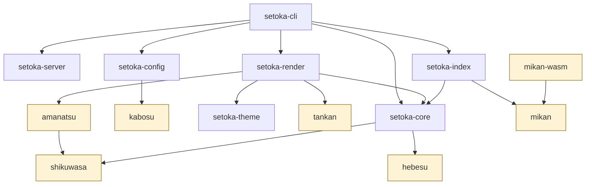

# アーキテクチャ

このセクションは、setoka 本体の内部設計を説明する開発者向けのページです。
使い方は[ガイド](../guide/index.md)を見てください。

setoka は Cargo workspace（MSRV 1.99 / edition 2024。公開ライブラリの kabosu・tankan も同じ）で、役割ごとに
crate を分けています。

## ワークスペース構成

    crates/
    ├─ tankan       # Mermaid 互換描画（テキスト → SVG。setoka 非依存・crates.io 公開）
    ├─ setoka-core    # comrak パース → Document/サイトモデル（nav・TOC・slug・sourcepos）
    ├─ setoka-render  # サイトモデル → HTML（minijinja・syntect・mermaid 変換・base path 解決）
    ├─ setoka-config  # setoka.toml の探索・スキーマ・解決（パーサは kabosu）
    ├─ kabosu       # TOML パーサ・エンコーダ（依存ゼロ・no_std。setoka 非依存・crates.io 公開）
    ├─ shikuwasa    # YAML の安全な読み込み（frontmatter・API 仕様。setoka 非依存・crates.io 公開）
    ├─ amanatsu     # OpenAPI / JSON Schema → 静的 HTML（setoka 非依存・crates.io 公開）
    ├─ hebesu       # 日本語の表記ゆれの検査（依存ゼロ・setoka 非依存）
    ├─ setoka-theme   # デフォルトテーマ（rust-embed: テンプレ + CSS + JS + mermaid.js）
    ├─ setoka-cli     # CLI（bin: setoka）
    ├─ setoka-server  # preview/watch 用最小静的サーバ + notify 監視
    ├─ setoka-index   # 検索インデクサ（ページ抽出・ファイル I/O・wasm 成果物の同梱）
    ├─ mikan        # 索引フォーマットと検索エンジン（native/wasm で 1 実装共有・crates.io 公開）
    └─ mikan-wasm   # クライアント検索クエリエンジン（cdylib。wasm 成果物のビルド用）

## 依存方向（凍結）

依存方向は凍結しており、逆方向の依存は作りません（）。
図はこのサイトのビルド時に tankan が SVG 化したものです:

Figure: crate 間の依存方向（色付きは setoka 非依存の汎用ライブラリ） {#fig:deps}

色を付けた **tankan・mikan・mikan-wasm・kabosu・shikuwasa・amanatsu・hebesu** は setoka の他の
crate に依存しない汎用ライブラリです。tankan（Mermaid SSR）と mikan（検索エンジン）
は [crates.io で公開](https://crates.io/crates/mikan)しており
（開発はこの monorepo で一体のまま）、書き側集約は `mikan::build`、読み側クエリエンジンは
`SearchEngine` にあり、setoka-index はページ抽出とファイル I/O だけを担う
薄い呼び出し側です）。kabosu（TOML）は setoka-config の唯一の通常依存で、
設計は [kabosu の設計](kabosu.md)を参照してください。shikuwasa（YAML）は setoka-core の
frontmatter と amanatsu が使う読み込み口で、v0.22 で setoka-core から切り出しました。amanatsu（OpenAPI /
JSON Schema を静的 HTML にする）は v0.22 で setoka-render から切り出しました（見た目の CSS は setoka のテーマに
あります）。hebesu（全角英数・半角カナ・長音符のゆれ・用語辞書の検査）は v0.22 で setoka-core の lint から
切り出しました。setoka-core は Markdown から本文のテキストを取り出して渡し、結果を診断に変えます。

## 凍結した設計判断

Web 調査込みで確定済みの技術選定です（差し替えない前提）。

| 領域 | 採用 | 要点 |
| --- | --- | --- |
| Markdown パース | comrak | GFM 完備・可変 AST・sourcepos（lint 用）・`format_commonmark`（fmt 用）。frontmatter は YAML（front matter extension）。パーサは setoka-core 内部に隠蔽し、公開 API はパーサ非依存 |
| テンプレート | minijinja | ランタイム解釈 ＝ 将来 dev でテンプレのホットリロードが可能 |
| ハイライト | syntect ＋ two-face | pure-Rust（onig 非依存）。CSS クラス出力でビルド時実行。two-face（bat のアセット由来）が TypeScript / TSX / TOML / Dockerfile 等を補完する |
| CLI | clap（derive）＋ `clap_complete` | 終了コード規約は 0 / 1 / 2。サブコマンドをまたぐ実行文脈（`--root`）は `Cx` 1 つにまとめて各 `run()` へ渡す。シェル補完は clap の定義から実行時に生成する（同梱しない・動的補完は使わない） |
| 設定 | TOML（kabosu） | `setoka.toml` を自作の依存ゼロパーサ kabosu で読む（手書き decode・span 付き診断・未知キーは設定エラー）。上方向探索でルート確定（`--root` 指定時は探索しない）。v0.14 で serde ＋ JSONC から移行 |
| YAML | saphyr（YAML 1.2） | frontmatter と openapi / jsonschema を shikuwasa（v0.22 で setoka-core の `yaml` モジュールから切り出した crate）1 か所で読む。型の検査は自前（日本語・ファイル上の位置・全件）で、YAML 1.1 の書き方（`yes` / `no`・`010`）は黙って読み替えずエラーにする。v0.20 で `serde_yaml_ng` から移行 |
| テーマ同梱 | rust-embed | バイナリ埋め込み＋ `theme/` でファイル単位の上書き |
| Mermaid | 既定はクライアント描画 | `[markdown.mermaid]` の `backend = "ssr"` で自作 SSR（tankan）に切り替える。未対応の図種は自動でクライアント描画へフォールバックする |
| dev サーバ | axum ＋ notify ＋ WebSocket | `/__livereload` への push でリロード |
| ページ並列化 | rayon | render / index のページループをデータ並列化。出力はスレッド数に依らずバイト同一 |
| ネットワーク I/O | 既定経路に入れない | build / check / dev はオフラインで決定的。外部リンクの到達性検査は `setoka check --external-links` の opt-in だけで、HTTP は `curl` へ委譲して依存グラフに HTTP クライアント・TLS を持ち込まない |

## tankan の設計原則

- **I/O なし・時刻 / 乱数非依存**（wasm32 対応の担保。gantt の today 線は
  意図的に描きません）
- SVG のテーマ追従は `<style>` ＋ CSS 変数方式。ユーザ指定色
  （`classDef` / `:::` / `style`）はインライン style 属性で直接埋め、
  テーマに追従させないのが正です
- `render_svg` が Err を返すと setoka 側が自動でクライアント描画に
  フォールバックするため、**図種の追加はパーサ・レイアウトの実装に
  集中できます**

## さらに読む

- [kabosu の設計](kabosu.md) — 依存ゼロの TOML 設定ライブラリと setoka-config の責務分離
- [検索の内部設計](internals-search.md) — トークナイザ整合・位置情報インデックス・OPFS
- [インクリメンタルビルドの内部設計](internals-build.md) — 3 層キャッシュキーと決定性
